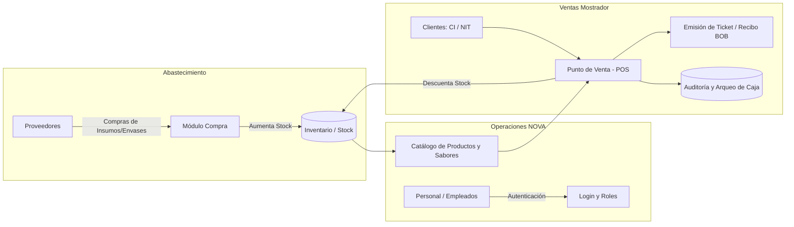
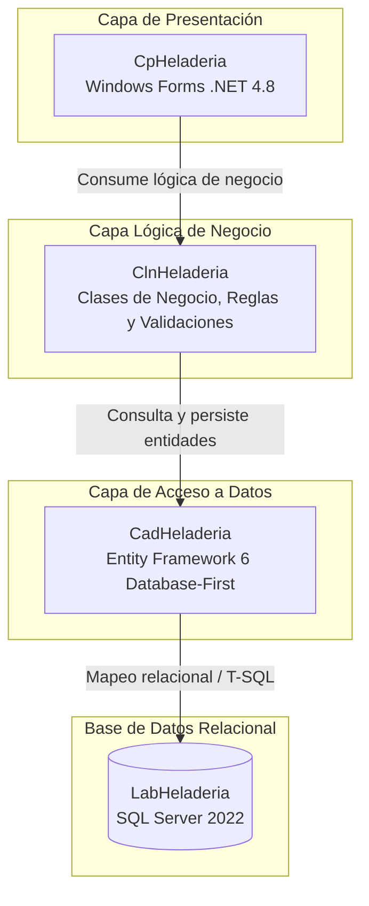
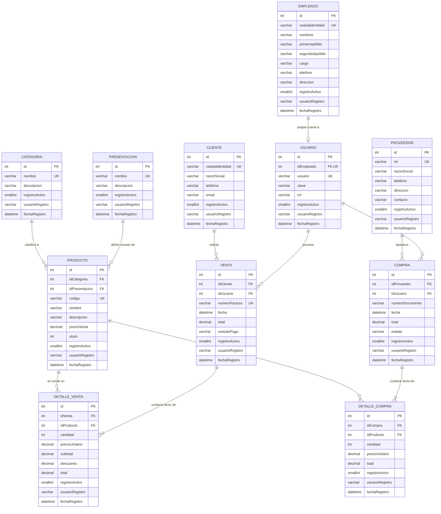

# 🍦 Sistema de Gestión Integral: Heladería NOVA

[-0078D7?logo=windows&logoColor=white)](https://docs.microsoft.com/en-us/dotnet/desktop/winforms/)
[-6C287E?logo=dotnet&logoColor=white)](https://docs.microsoft.com/en-us/ef/ef6/)

[-brightgreen)](#-arquitectura-del-software-y-convenciones-del-sistema)

---

## 🍨 Visión y Modelo de Negocio

### 1.1 Contexto
**Heladería NOVA** es una empresa boliviana dedicada a la producción y comercialización de helados artesanales premium, caracterizados por el empleo de fruta natural de temporada como maracuyá, tumbo, chirimoya, frutilla, cacao y combinaciones tradicionales locales. 

Tradicionalmente, las micro y pequeñas heladerías en Bolivia gestionan sus operaciones mediante anotaciones en cuadernos o planillas de Excel desarticuladas, lo cual produce:
- **Pérdida de inventario y desabastecimiento:** Falta de trazabilidad en los insumos perecederos y stock de helados terminados.
- **Lentitud en mostrador:** Demora en la emisión de notas de venta / recibos en horas pico.
- **Falta de control financiero:** Discrepancias entre las ventas declaradas y el dinero físico en caja al final de la jornada.
- **Falta de seguridad:** Ausencia de roles, permitiendo que cualquier persona modifique precios o elimine registros contables.

### 1.2 Propuesta de Valor y Solución Tecnológica
El proyecto **`Sis457Heladeria`** proporciona una plataforma desktop robusta, rápida e intuitiva, que opera de forma local/cliente-servidor sin depender de internet para la cobranza en mostrador, garantizando:
1. **Control de Inventario y Producción:** Registro de sabores, presentaciones (cono simple, cono doble, vasito térmico, litro para llevar, copas artesanales) y productos terminados.
2. **Punto de Venta (POS) Ágil:** Cobro rápido en Bolivianos (BOB), vinculación obligatoria de clientes con CI/NIT y Razón Social conforme a las normas de facturación/recibos de Bolivia.
3. **Abastecimiento Seguro (Compras):** Registro de compras a proveedores de insumos (lácteos, azúcar, frutas, envases) con actualización inmediata de existencias.
4. **Seguridad y Trazabilidad:** Eliminación lógica de datos (los registros nunca se destruyen físicamente; pasan a `registroActivo = -1`), auditoría automática (`usuarioRegistro`, `fechaRegistro`) y control de accesos basado en roles (Administrador, Cajero/Vendedor, Almacenero).

---

## 🧊 Arquitectura del Software y Convenciones del Sistema

El sistema implementa una arquitectura en tres capas desacopladas (**3-Tier Architecture**), promoviendo alta cohesión, bajo acoplamiento y estricta separación de responsabilidades.

### 2.1 Especificación de Capas y Proyectos de la Solución

| Proyecto / Componente | Tipo de Proyecto | Responsabilidad Principal |
| :--- | :--- | :--- |
| **`Sis457Heladeria`** | *Solución Visual Studio* | Contenedor principal que orquesta y agrupa los 3 proyectos del sistema. |
| **`CadHeladeria`** | *Class Library (.NET Framework 4.8)* | **Capa de Acceso a Datos (CAD):** Contiene el modelo Entity Framework 6 (`LabHeladeriaModel.edmx`), las clases de entidad autogeneradas (`POCO`), el contexto `LabHeladeriaEntities` y métodos directos de persistencia. |
| **`ClnHeladeria`** | *Class Library (.NET Framework 4.8)* | **Capa Lógica de Negocios (CLN):** Contiene las clases estáticas o de servicio (`ProductoCln`, `VentaCln`, `EmpleadoCln`, `UsuarioCln`). Aplica validaciones de reglas de negocio, transaccionalidad (`DbContextTransaction`), encriptación de claves y aislamiento de consultas activas (`registroActivo = 1`). |
| **`CpHeladeria`** | *Windows Forms App (.NET Framework 4.8)* | **Capa de Presentación (CP):** Formularios de interfaz gráfica, validaciones visuales con `ErrorProvider`, formateo de divisas bolivianas (`Bs.`), gestión de la sesión global del usuario autenticado y experiencia de usuario (UX). |
| **`LabHeladeria`** | *Base de Datos Relacional (SSMS 22)* | Base de datos física con integridad referencial, restricciones `CHECK`, valores por defecto, disparadores/auditoría y compatibilidad T-SQL ANSI. |

---

## 🥶 Diseño y Modelado de la Base de Datos (`LabHeladeria`)

La base de datos sigue la **Tercera Forma Normal (3NF)** y asegura que todas las tablas cuenten con columnas estándar de auditoría y soporte para **eliminación lógica**.

### 3.1 Estándar de Auditoría y Eliminación Lógica

| Columna | Tipo de Dato | Restricción | Descripción |
| :--- | :--- | :--- | :--- |
| `usuarioRegistro` | `VARCHAR(50)` | `NOT NULL DEFAULT SUSER_NAME()` | Cuenta de usuario de Windows/Sistema que ejecutó la inserción o actualización. |
| `fechaRegistro` | `DATETIME` | `NOT NULL DEFAULT GETDATE()` | Marca de tiempo exacta en que se persistió el registro. |
| `registroActivo` | `SMALLINT` | `NOT NULL DEFAULT 1` | Bandera de estado: **`1` = Activo**, **`-1` = Eliminado lógicamente**. |

### 3.2 Diagrama Entidad-Relación (Mermaid ERD)

---

## ❄️ Cronograma de Hitos y Plan de Ejecución (Roadmap)

Plan de trabajo estricto con fechas y entregables que conducen a la presentación final del laboratorio:

| Hito | Fecha Límite | Fase del Proyecto | Entregables Principales y Criterios de Aceptación |
| :---: | :---: | :--- | :--- |
| **01** | **16/10/2026** | **Capa de Acceso a Datos y Consolidación de Entidades** | • Creación y ejecución del script `LabHeladeria.sql` en SSMS 22. • Creación de la solución `Sis457Heladeria` y proyecto `CadHeladeria`. • Configuración del modelo Entity Framework 6 (`.edmx`) mediante *Database-First*. • Consolidación de cadenas de conexión y verificación de entidades autogeneradas. |
| **02** | **23/10/2026** | **Capa Lógica de Negocios y Diseño Inicial de Interfaces** | • Creación de la librería de clases `ClnHeladeria`. • Creación del proyecto de interfaz `CpHeladeria` (WinForms .NET 4.8). • Prototipado y diseño visual del Menú Principal MDI / Dashboard (`FrmPrincipal`). • Wireframes y esqueletos de formularios: `FrmLogin`, `FrmProducto`, `FrmEmpleado`, `FrmVenta`, `FrmCliente`. |
| **03** | **30/10/2026** | **CRUD Completo de 2 Tablas, Login y Menú Principal** | • Implementación del `FrmLogin` con encriptación SHA-256 y roles en `UsuarioCln`. • CRUD 1 completo (`Producto`) con al menos 6 campos y eliminación lógica (`registroActivo = -1`). • CRUD 2 completo (`Empleado`) con datos de personal y eliminación lógica. • Integración de validaciones con `ErrorProvider` para impedir campos vacíos. • Refinación del menú principal con control dinámico de permisos por rol. |
| **04** | **06/11/2026** | **Módulo Transaccional de Venta / Compra (Funcionalidad Clave)** | • Implementación de `FrmVenta` y `VentaCln` con transacción atómica Maestro-Detalle. • Búsqueda y selección interactiva de cliente y productos. • Grilla dinámica de items con cálculo automático de totales en Bs. • Descuento automático de stock en inventario y control de stock insuficiente. • Base del módulo de Compra para abastecimiento de materias primas. |
| **05** | **10/11/2026** | **Refinación de Transacciones y Documentación Inicial** | • Pulido de la experiencia de usuario (UX) en el punto de venta. • Generación de ticket/recibo para impresión o visualización preliminar. • Manejo global de excepciones (`try/catch`) y mensajes amigables con `MessageBox`. • Generación de la primera versión del manual de usuario y diccionario técnico. |
| **06** | **13/11/2026** | **Refinamiento Integral y Pruebas con Usuarios Finales (QA)** | • Pruebas de estrés y casos extremos (venta de stock en cero, caracteres especiales en CI/NIT). • Pruebas de usabilidad simuladas con cajeros y administradores. • Optimización de tiempos de carga en grillas y consultas LINQ. • Depuración final de bugs y ajustes estéticos de tipografía y colores. |
| **07** | **16/11/2026** | **Generación de Acceso Directo y Presentación Final** | • Generación del instalador / Release ejecutable compilado en modo `Release x86/x64`. • Creación del icono institucional y acceso directo en el escritorio de Windows. • Ensayo de defensa técnica y entrega final formal del Laboratorio de SIS457. |

---

## 👥 Equipo de Desarrollo y Control Académico
- **Desarrollador:** Cusipuma Ortega Ariel
- **Desarrollador:** Gutierrez Rojas Aldo
- **Materia:** SIS457 - Fundamentos de Programación
- **Institución:** Universidad Mayor, Real y Pontificia de San Francisco Xavier de Chuquisaca (USFX)
- **Negocio:** Heladería Artesanal NOVA
- **Docente:** MSc. Ing. Esnor Noel Enrique Vaca Moreno
- **Fecha de Entrega Final:** 16 de Noviembre de 2026
